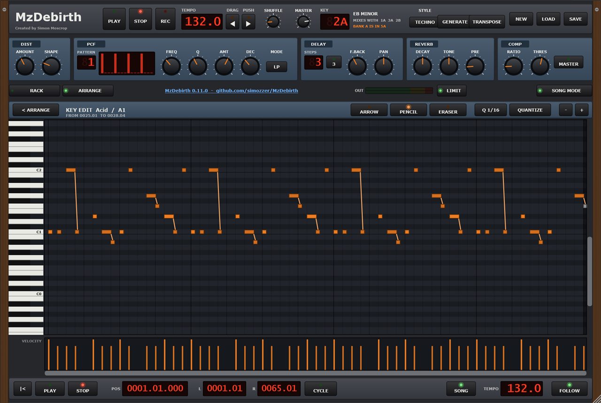
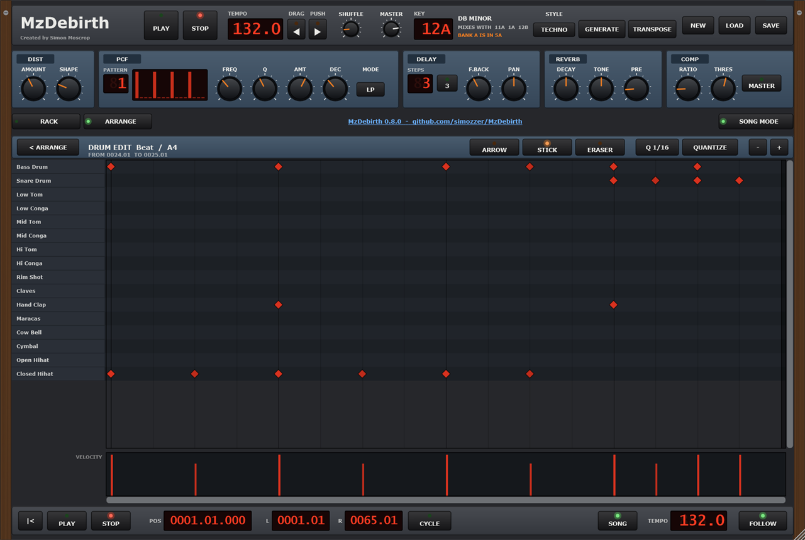
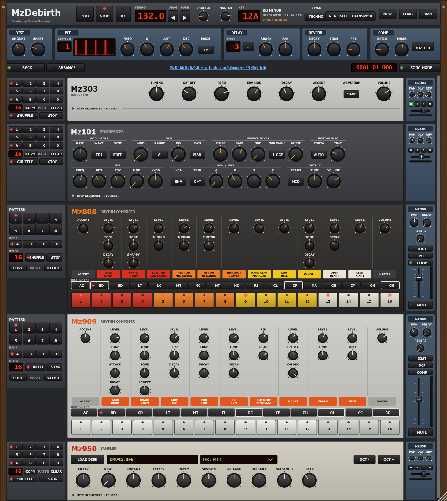
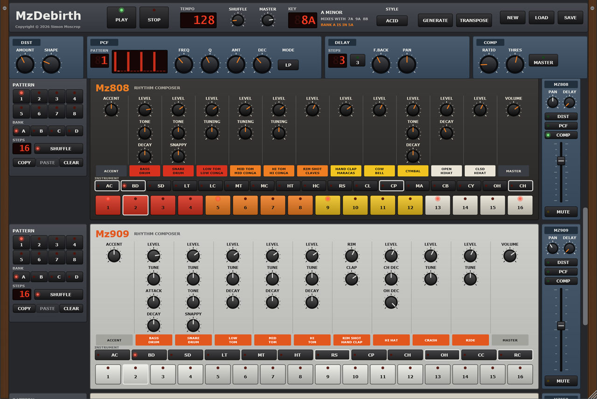

# MzDebirth

A rack of the Mz synths, played from a step sequencer, in the spirit of the old ReBirth
RB-338: six machines, each with its own panel, its own patterns and a channel on the mixer,
all on one clock, with ReBirth's effects units and a reverb along the top. And beside the
rack, an [Arrange window](#the-arrange-window) after Cubase on the Atari ST, to lay the
patterns out as a song and write parts of any length - or [record](#recording-a-song) the
rack into it as you play, as ReBirth did.

**[Tutorial](docs/tutorial.md)** - your first half hour, step by step &nbsp;·&nbsp;
**[Troubleshooting](#troubleshooting)** - when a button seems to do nothing &nbsp;·&nbsp;
**[Download](https://github.com/simozzer/MzDebirth/releases/latest)**

It plays the synths' real engines - [Mz303](https://github.com/simozzer/Mz303),
[Mz101](https://github.com/simozzer/Mz101), [Mz808](https://github.com/simozzer/Mz808),
[Mz909](https://github.com/simozzer/Mz909), [Mz950](https://github.com/simozzer/Mz950) and
[Mz7](https://github.com/simozzer/Mz7) -
and its PCF is [MzPCF](https://github.com/simozzer/MzPCF)'s. Nothing is copied: each engine
is compiled straight from its own repository, so a fix to a synth or the PCF reaches the rack
too.

## Getting it

Download **MzDebirth-*version*-win64-Setup.exe** from the
[releases page](https://github.com/simozzer/MzDebirth/releases) and run it. It installs the
app, a Start menu entry, an uninstaller, and the Mz950's fifteen sample disks - a piano, a choir, woodwind, brass,
strings, birdsong, the sea and whales among them; installing for just yourself needs no administrator rights. The
**win64.zip** beside it is the same, to run without installing - keep the `disks` folder next
to `MzDebirth.exe`.

Windows 10 or 11, 64-bit. The app is not code-signed, so Windows may warn about an unknown
publisher: choose **More info**, then **Run anyway**.

### macOS (beta)

Download **MzDebirth-*version*-macOS-beta.zip** from the
[releases page](https://github.com/simozzer/MzDebirth/releases) and unzip it. It holds the
app and the Mz950's disks, for Apple Silicon and Intel Macs on macOS 11 or later.

It isn't signed by Apple, which takes a paid developer account, so macOS won't open it with a
double-click. Install it from Terminal instead. Type `bash ` (with the space), drag
`install.sh` from the unzipped folder into the Terminal window, and press Return:

    bash ~/Downloads/MzDebirth-<version>-macOS-beta/install.sh

It puts the app in Applications and the disks in `~/Library/Application Support/MzDebirth`,
with no password needed, and clears the "downloaded from the internet" flag that would stop
the app opening. `READ ME FIRST.txt` in the zip explains how to install by hand instead.

It's a beta: built on GitHub's Macs, where it passes the same checks as the Windows version,
but not yet tried on a real one. If something doesn't work, please
[open an issue](https://github.com/simozzer/MzDebirth/issues).

### Linux (beta)

For 64-bit x86 PCs running Ubuntu 22.04 or later, or another distribution as new, and for
the **Raspberry Pi 5** on 64-bit Raspberry Pi OS (Bookworm or later). There are two
downloads for each on the [releases page](https://github.com/simozzer/MzDebirth/releases),
`amd64`/`x86_64` for a PC and `arm64` for the Pi; the PC's are shown here:

- **mzdebirth_*version*_amd64.deb**, for Ubuntu, Debian, Mint and the like. Install it with

      sudo apt install ./mzdebirth_<version>_amd64.deb

  It puts MzDebirth in the applications menu and a `mzdebirth` command on the path, with the
  app and its disks in `/opt/MzDebirth`, and fetches the libraries it needs. Remove it with
  `sudo apt remove mzdebirth`.
- **MzDebirth-*version*-linux-x86_64-beta.tar.gz**, for any distribution, nothing installed:

      tar -xzf MzDebirth-<version>-linux-x86_64-beta.tar.gz
      cd MzDebirth-<version>-linux-x86_64-beta
      ./MzDebirth

  Keep the `disks` folder beside it. `READ ME FIRST.txt` in it lists the few libraries it
  needs, if a minimal system lacks them.

On a **Raspberry Pi 5**, install `mzdebirth_<version>_arm64.deb` the same way, and find
MzDebirth under Sound & Video. The Pi is much slower than a desktop PC, so if the sound
crackles, raise the buffer size under Options. It's built natively on GitHub's ARM machines,
passes the same checks as the others, and has been played on a Pi 5.

It plays through ALSA, which PipeWire and PulseAudio both provide. It runs under **WSL** on
Windows 11 too; WSL has no sound card, so it needs ALSA's PulseAudio plugin, which the .deb
installs and sets up - `READ ME FIRST.txt` says how by hand. It's a beta: built on GitHub's
Ubuntu machines, where it passes the same checks as the Windows version, and run on Ubuntu
24.04 under WSL, but not yet tried much on real Linux desktops.

## Getting started

**New to it? Start with the [tutorial](docs/tutorial.md)** - half an hour from the demo song
to a song of your own. If a button seems to do nothing, see
[Troubleshooting](#troubleshooting): usually it's SONG MODE.

- **Options** (top left) picks the audio output.
- **The window**: drag it wider and everything grows with it; drag it taller (from 800
  pixels) and you see more of the rack at once, or more of the song. It opens at the size
  it was left.
- **PLAY**, or the space bar, plays and **STOP** stops. A new rack opens on the **demo
  song** - an acid rave tune made from the factory grooves, two minutes of intro, builds,
  drops and a breakdown - in the Arrange window. Turn **SONG MODE** off and every machine
  plays its own pattern, A1 to start with. **REC**, beside them, records the rack into the
  song - see [Recording a song](#recording-a-song).
- Pick another pattern on each machine's **PATTERN** pads - bank A to D, then 1 to 8. Picked
  while playing, it blinks, and starts when the pattern playing comes round. The factory
  banks are written so that pattern *n* of every machine plays with pattern *n* of the others:
  **A** acid house, **B** techno, **C** electro, **D** deep house; in each, 1-3, 6 and 7 are
  grooves, 4 and 8 fills, and 5 a breakdown.
- **TEMPO** is to a tenth of a beat a minute: drag it or use the wheel for whole beats, with
  **Shift** held for tenths, and double-click for 120.
- **DRAG** and **PUSH**, beside it, work like the pitch bend on a CD deck, for playing the rack
  in time with a record. Held, they slow the rack or hurry it - 3% at once, building to 10%
  over two seconds - and let go, it is back on its tempo with the beat moved. The tempo shows
  the bent figure while one is held. The **left and right arrow keys** do the same.
- **NEW** brings the factory grooves back with a demo song - the **acid demo**, or the
  **ambient demo** - or clears the rack to write your own.
- **SAVE** and **LOAD** keep whole racks - patterns, knobs, mixer, effects and the song - in
  `.mzdebirth` files. The app also remembers where it was left.
- **RACK** and **ARRANGE** (or F1 and F2), under the effects, switch between the rack and
  the Arrange window, where the patterns become a song - see below.
- In the rack, the display beside **SONG MODE** shows where the song is, in bars, beats and
  ticks: where it's playing, how far a recording has got, or the cursor.
- **OUT**, in the same row, is the master's meter, and **LIMIT** beside it keeps the output
  from clipping - see [Effects and the mixer](#effects-and-the-mixer). If LIMIT's light is
  orange much of the time, turn the MASTER down a little.
- **EXPORT**, in the Arrange window, saves the song as a WAV or FLAC file.
- The link between the tabs shows the version you have; click it for the project page,
  where the next version, what's new in it and the issue tracker are.

## The Arrange window

A second way to work, after Cubase on the Atari ST: the song laid out along a ruler of bars,
a track for each machine down the left - the rack's six, in its order, one each - and on
each track *parts*: notes of any length at any position, not 16-step patterns. The rack is
still a click away, for the sound: every knob, fader and effect plays the song as it plays
the patterns, and a track's **RACK** goes straight to its machine.

The **demo song** a new rack opens with shows the way: bank A's grooves laid out over 64
bars at 132 bpm, with parts written for it. In the first build the kick drops away, a 909
snare roll speeds up from quarters to 32nds, and a 101 riser climbs C minor. Each build cuts
out a beat before the drop, which lands with a crash. The breakdown holds the 101 long over
the chords, gliding between them, and halfway through it a long snare roll starts, almost
silent, and builds for eight bars into the second drop. The song has automation too: the
909's snare level brings the rolls up, the 303's filter opens as the acid line comes in and
through each build, the 101's filter opens with each riser, and its reverb is turned up for
the breakdown. The 909's track carries both its grooves and the rolls, and
the 101's both the lead and the risers and pad, which take turns.

The **ambient demo**, from **NEW**, is the other kind of song: something to fall asleep to.
It's 64 bars at 72 bpm in E flat, about three and a half minutes, with no drums. The Mz950
loads its `WHALES` disk, on the `WHALE SEA` programme, and holds the sea the whole way
through, with whale calls drifting in over it. These are public-domain recordings of
humpbacks, a blue whale, a minke and an orca. The Mz7 plays slow chords on `WARM PAD`, the 101
a slow melody through a long echo, and the 303 a soft low pulse. At the end the sea fades
away. The factory grooves are in the banks as usual, except the Mz950's, which need the drum
disk.

- **SONG MODE** (beside the tabs) chooses what plays the machines: the song, or - off, as
  ReBirth's PATTERN mode - their patterns. Changed while playing, it waits for the bar.
  PLAY in the Arrange window turns it on.
- **Getting started:** right-click a track's lane and *Insert a pattern* from the rack. It
  becomes a part that plays exactly as the pattern did - slides, accents, ties and shuffle
  and all - so the factory grooves, GENERATE and TRANSPOSE all feed the song. Or play the
  rack into the song live - see [Recording a song](#recording-a-song).
- **The toolbox** is along the top, and on the right mouse button as on the ST:
  - **ARROW** picks, moves (to another track of the same kind too), copies with Alt-drag, and
    resizes by the right edge. As with a clip in Ableton Live, a part dragged longer repeats
    to fill the length, and dragged shorter and out again it still repeats its loop.
  - **PENCIL** draws an empty part.
  - **ERASER** and **MUTE** do what they say.
  - **SCISSORS** cuts a part in two.
  - **GLUE** joins a part to the next.
  - **SNAP** sets what they all keep to: a bar, a beat, a sixteenth, or nothing. The
    toolbox menu also *Repeats* parts and renames them.
- **The tracks:** one for each machine, so the song and the rack always match. M mutes a
  track, S solos it, SH has it swing with the SHUFFLE knob, and **RACK** shows that machine
  in the rack, ringed for a moment, to turn its knobs. Right-click a track to rename or
  recolour it, or to clear its automation. **A** beside a track's name means it has
  automation, drawn as lines over its lane, and the **AUTOMATION** selector under the name
  picks which of them to show. The **FX** row under the tracks holds the effects units'
  automation. A song saved by 0.5 or before with two tracks for one machine opens with them
  merged into one, sounding as it did.
- **The ruler:** click to move the cursor (and the song, while it plays). Drag the **L** and
  **R** flags for the locators, or shift-drag to set both. Double-click to turn the cycle
  on or off.
- **The transport** along the bottom: back to the start, PLAY from the cursor, STOP (which
  leaves the cursor where the song stopped), the position in bars, beats and ticks, the
  locators, CYCLE and FOLLOW. The ST's numeric keypad works as it did: **Enter** plays,
  **0** stops, **.** goes back to the start, and **/** turns the cycle on and off. With
  **REC** on in the transport at the top, PLAY here records a take.
- **Ctrl+Z** undoes any edit to the song and **Ctrl+Y** redoes it. **Ctrl+C** and
  **Ctrl+V** copy parts and paste them at the cursor, **Delete** deletes them, and
  **Ctrl+A** picks every part.
- **EXPORT**, at the right of the toolbar, saves the song as a **WAV** or **FLAC** file, 24-bit
  at 48 kHz. It renders the whole song, or just between the locators when CYCLE is on, with
  four seconds more for the delay and reverb to ring out. It runs on a copy of the rack, much
  faster than real time, so you can keep playing while it works. LIMIT is in the export as
  it is in the output, so the file never clips. For an MP3, convert the WAV with any
  converter.

Double-click a part to edit it:

- **KEY EDIT**, for the Mz303, Mz101 and Mz950:
  - the keys down the side, and on the 950 the names of the samples its programme plays;
  - draw notes with the PENCIL, a **Q** long or dragged longer;
  - move and stretch them with the ARROW;
  - on the 303 and 101, a note that overlaps the next slides into it, and is drawn joined
    to it.
- **DRUM EDIT**, for the Mz808 and Mz909: the instruments down the side. The STICK strikes
  a step, takes a hit away, or accents it with Alt-click.
- **Both editors:**
  - drag across the **VELOCITY** lane to draw the velocities - 110 and up is an accent;
  - **Q** sets the grid, and **QUANTIZE** (or the Q key) moves the notes picked, or all of
    them, on to it;
  - **Escape** goes back to the Arrange window.

## The machines

- **Mz303** - the full panel, and a piano-roll step editor with the 303's UP, DOWN, ACCENT
  and SLIDE on every step. Click a cell for a note, click it again for a rest, drag along
  to keep going. A slide holds the note over into the next step and glides to it.
- **Mz101** - the panel in its sections, less what the rack does for it (its arpeggiator,
  sequencer and clock). The same step editor without ACCENT, which the 101 has none of; its
  SLIDE is a legato, which glides when PORTAMENTO is on AUTO. SYNC on TEMPO locks its
  modulator to the rack.
- **Mz808** and **Mz909** - the full panels, a column per instrument, and the hardware's way
  of writing a beat: pick an instrument on the select row (or AC for the accents) and its
  steps show on the sixteen keys. An instrument with steps written has a bright edge.
- **Mz950** - plays S900/S950 disk images: **LOAD DISK**, then pick a programme. Its steps
  are a grid of notes, any number on a step, with ACCENT and TIE rows; a tied step carries
  on the notes it shares with the step before. The keys the programme plays are lit, and a
  drum kit's are named by their samples. It opens with the drum disk that comes with Mz950;
  **LOAD DISK** finds the other eleven beside it - basses, leads, pads, keys, textures, a
  grand piano, a choir singing "ooh" and "aah", woodwind, brass, and solo and ensemble
  strings. Loading a disk puts the Mz950's knobs back where they start, all but GAIN.
- **Mz7** - a DX7, from [Mz7](https://github.com/simozzer/Mz7): pick a cartridge - one of the
  four it comes with, 128 voices of electric pianos, basses, brass, bells, pads and effects -
  or **LOAD .SYX** for any DX7 cartridge, then a voice. **BRIGHT** moves the voice's
  modulators, **ATTACK**, **DECAY** and **RELEASE** lengthen or shorten every envelope, and
  **MOD** is the mod wheel, so whatever vibrato the voice gives it. Its steps are a grid of
  notes like the Mz950's - chords, accents and ties. GENERATE gives it chords in the key.

The step editors of the **Mz303**, **Mz101**, **Mz950** and **Mz7** fold away: click the
**STEP SEQUENCER** bar over one, and the machine folds down to its knobs, its pattern
section and mixer strip packing down beside them (the inserts and MUTE as lettered keys that
glow when on, the fader and meter on their sides). The bar stays where it was, under the
knobs, to unfold it again. The rack remembers which are folded.

Every machine has four banks of eight patterns, of up to sixteen steps (**STEPS**), with
**COPY**, **PASTE** and **CLEAR**, and its own **SHUFFLE** switch: whether it swings with the
transport's SHUFFLE knob. A copied pattern pastes onto another machine where it fits: a
mono synth's line onto the other mono synth, or onto the Mz950 or the Mz7 as notes; the
Mz950's and the Mz7's notes onto each other; a drum pattern only onto its own machine.
Chords don't paste onto a mono synth.

Each has a **STOP** too, for taking a machine out of the mix in time: pressed while playing,
it blinks, and at the start of the next bar the machine lets go of its notes and plays
nothing more - its delay and reverb ringing on. It stays lit while stopped. To bring it back,
pick a pattern on its pads: it comes in again at the start of the next bar, from the top of
that pattern. It works in SONG mode as well, where a stopped machine's notes go by unplayed.

## Recording a song

A song is made as it was in ReBirth, by playing the rack live: its patterns go into the
Arrange window as you pick them, and the knobs you turn go in as
[automation](#automation). Each stretch of one pattern on a machine becomes a part named
after it (A1, B3 and so on), so the song shows what you played and when. A pattern picked
always comes in on the next bar.

### A take

A take records every machine, from the cursor:

1. Put the Arrange window's cursor where the take should go. It starts on that bar, or on
   the next if the cursor is part way through one.
2. Press **REC** in the transport at the top (it blinks), then **PLAY** in either transport,
   or the space bar. Every machine plays its patterns from the top.
3. Pick patterns, STOP machines and bring them back as you go. The take appears in the
   Arrange window as you play, and in the rack the display beside SONG MODE shows how far it
   has got.
4. Press **STOP** to end the take, or **REC** again to end it and keep playing.

The take records over every track for the bars it ran, including the bar it stopped in, and
a STOPped machine leaves its bars empty. Recorded from SONG mode, the rack goes back to SONG
mode when the take is over, so PLAY plays the song with the take in it. One **Ctrl+Z** takes
the whole take back.

### Playing patterns over the song

While the song plays, a pattern picked on a machine takes that machine over from its track
at the next bar and plays from the top, and the song's notes for it go by. Its pads stay
dark while the machine follows the song, and light when a pattern has it. Click the lit
pattern again to hand the machine back to the song at the next bar. STOP lets every pattern
go, so the next PLAY plays the song as written.

### Overdubbing

An overdub records those patterns into the song as it plays:

1. With the song playing, press **REC**. It lights, and the song plays on as before.
2. Pick a pattern on any machine. It takes that machine over at the next bar, and from that
   bar it's recorded into the machine's track. Change patterns, or pick them on other
   machines, as you go.
3. Press **REC** again. Every machine goes back to the song at the next bar (REC blinks
   until then), and the overdub ends there.

Only the bars each machine played are recorded over. Machines you didn't touch, and the rest
of the song, stay as they were. STOP ends an overdub too, and one **Ctrl+Z** takes the whole
of it back.

### Automation

While a take or an overdub is recording, every knob and switch you move is recorded too, as
ReBirth recorded its tweaks. That covers each machine's panel, its mixer strip (fader, pan,
DELAY and REVERB sends, DIST, PCF and COMP switches, and MUTE), and the effects units along
the top. To record moves alone over a song, start an overdub with **REC** and turn the knobs
without picking a pattern.

- A knob's moves are recorded from where you take hold of it to where you let go, replacing
  whatever was recorded for that knob over those ticks.
- When the song plays, the recorded knobs turn by themselves: knobs glide between the points
  recorded, and switches jump. Take hold of one and the song leaves it to you until you let go.
- In the Arrange window, each track draws its automation as lines over its lane, low to high
  across the control's range, and shows an **A** beside its name when it has any. The effects
  units' automation is on the **FX** row under the tracks.
- The **AUTOMATION** selector along the foot of each track, and of FX, chooses which lines
  it draws: all of them, none, or one control's, which is then labelled at the right of the
  lane.
- To clear a track's automation, right-click it and choose **Clear automation**. Right-click
  **FX** to clear the effects units'. Ctrl+Z brings it back.

## Effects and the mixer

ReBirth's four units, and a reverb, along under the transport:

- **DIST** - drive, and a shape from soft, to hard, to a lopsided fuzz.
- **PCF** - a filter played by one of 32 step patterns: struck on every sixteenth at that
  step's level, closing again by DEC; low-pass or band-pass. The same as the
  [MzPCF](https://github.com/simozzer/MzPCF) plugin, to use on any track in a DAW.
- **DELAY** - echoes 1 to 16 sixteenths behind at the rack's tempo, or triplets, with
  feedback and pan. They ring on after STOP.
- **REVERB** - a room, from small to a long hall (**DECAY**), dark to bright (**TONE**), with
  up to 150 ms of **PRE**-delay so the sound itself comes through first. A send, as the
  DELAY is, and it too rings on after STOP.
- **COMP** - ratio and threshold, for the channels switched into it, and for the whole mix
  with **MASTER**.

Each machine's mixer strip has its pan, its **DELAY** and **REVERB** sends, its switches
into **DIST**, **PCF** and **COMP** - in that order, before the fader - its fader and **MUTE**, and a
stereo **meter** beside the fader. The meter reads what the machine puts into the output,
after its fader, pan and the MASTER: green to -12 dB, yellow to 0, and red over it, where
that machine alone would take the output past full scale. It falls as a peak meter does,
with the highest point held for a second.

The factory rack is mixed to be heard at the level of a record. An 808 kick starts with one
big half-cycle, with its body - the weight you hear - some 20 dB under it, so left alone it
holds the whole mix down and the kick sounds thin. So the Mz808 goes through the **DIST**,
soft, as well as the **COMP**: that shaves the spike and adds the harmonics that let a kick
through small speakers, and the faders and MASTER come up into **LIMIT**. If your own rack
sounds weak in the low end, try the same on its kick.

The master has a meter too: **OUT**, beside the RACK and ARRANGE tabs, reads what the rack
puts out, left and right, after the MASTER and LIMIT. **LIMIT**, next to it, is a limiter on
the whole mix, the last thing before the output, so the rack never clips: it holds every
peak under -0.3 dBFS, looking 1.5 ms ahead so it is ready for each one. It is on to start
with. Its light is green while it waits and orange while it is taking something off - if it
is orange much of the time, turn the MASTER or a fader down. Racks saved by 0.9 or before open
with it on.

## Keys, for harmonic mixing

The **KEY** section names the key as Mixed In Key does, on the Camelot wheel: **1A-12A**
are minor, **1B-12B** major. Drag it or use the wheel to go round; click to swap A and B. It
shows the keys that mix with it, and the key of the bank the Mz303 is showing.

- **GENERATE** fills that bank, on every machine, with eight new grooves in the key and the
  **STYLE** - acid, techno, electro or deep - laid out as the factory banks are: bass lines
  and leads from the key's scale over a progression of its chords, drums varied from the
  style's factory patterns, and the Mz950 playing a kit's percussion or a tuned programme's
  chords. Every press writes new ones.
- **TRANSPOSE** moves that bank's bass lines and leads into the key, degree for degree - so
  C minor sent to 8B becomes C major, not just a different pitch. A bank written by hand has
  its key worked out from its notes. The drums are left as they are.

## Troubleshooting

**I pick a pattern or a bank and nothing changes.** SONG MODE is on - it is when a new
rack opens, on the demo song - so the song is playing the machines, not their pads. Click
**SONG MODE** so its light goes off, and PLAY plays the patterns you pick. (With the song
playing, a pattern you pick does take its machine over, from the next bar; click the lit
pattern again to give the machine back to the song.)

**I turn a knob and it springs back.** The song has automation for that knob - the demo
song turns the 303's CUT OFF, the 101's FREQ and REVERB, and the 909's snare LEVEL. While
you hold a knob it's yours; let go and the song has it again. Turn SONG MODE off, or clear
the track's automation (right-click it in the Arrange window, **Clear automation**).

**PLAY plays the demo song, not my patterns** - the same thing: SONG MODE is on.

**A machine is silent.** Check its **STOP** (lit means stopped - pick a pattern to bring it
back), its **MUTE**, its fader, and in the Arrange window the track's **M** and **S**. A
pattern can also simply be empty: the Mz808's and Mz909's steps show for one instrument at a
time, picked on the select row.

**No sound at all.** **Options**, top left, picks the output device. On Linux under WSL,
see the [Linux section](#linux-beta) - WSL needs ALSA's PulseAudio plugin.

**It crackles.** Raise the buffer size in **Options**. If the **LIMIT** light is orange much
of the time, the mix is running into the limiter: turn the MASTER or a fader down.

**The step grid is missing.** That machine is folded: click its **STEP SEQUENCER** bar.

**I lost my work.** **Ctrl+Z** in the Arrange window undoes edits to the song, takes and
overdubs included. The app remembers where it was left, but **SAVE** is the only way to keep
a rack for good.

Something else? Please [open an issue](https://github.com/simozzer/MzDebirth/issues).

## Building

On Windows, with Visual Studio's C++ tools. The repositories go side by side:

    src\
        JUCE\         9.0.2
        Mz101\
        Mz303\
        Mz808\
        Mz909\
        Mz950\        (or VirtualS950, its old name)
        Mz7\
        MzPCF\
        MzDebirth\

Mz950's sample disks are not in its repository. Make them once, with its disk generator:

    ..\Mz950\AkaiS950Synth\build.ps1 -To ..\Mz950\disks

then

    .\build.ps1             the sequencer check, then the standalone app
    .\build.ps1 -NoApp      the check only
    .\build.ps1 -Release    and the installer and the zip, into dist\ (needs Inno Setup 6)

The check (`Tests/SeqCheck.cpp`) holds the sequencer to its timing, slides and pattern
changes, checks each effect and every factory groove, generates in all 24 keys, and plays
each machine, before the app is built round it. It also holds the song to its sample: every
factory groove made into parts must play bit for bit as its patterns do. The cycle, STOP,
undo, a song edited while it plays, a part stretched to loop, a pattern played over the
song, a take, an overdub, automation played back, LIMIT and EXPORT are each checked. Every
control on the rack - 156 of them - is moved alone, by hand and by the song, and must move
nothing else. The
demo song is played through and held to its shape: drops louder than the intro and the
breakdown, a beat of near silence before each, the long roll's snare level climbing, and
every knob back where it started. So is the ambient demo: never a silent bar until the sea
fades, nothing loud, and every knob back. It links no JUCE. Without the disks it skips the Mz950's
checks and says so; `-Release` will not go on without them.

Pushing a version tag (`git push origin v0.3.0`) builds the installer and zip on GitHub -
disks and all - and attaches them to a draft release, with the notes in
`docs/releases/<tag>.md`. A Mac job then adds `MzDebirth-<version>-macOS-beta.zip` to the
same draft. It's `.github/workflows/mac.yml`, which also runs on every push to `main` as a
check. It makes the Mz950's disks itself, with the .NET SDK
(`installer/mac/MakeDisks.csproj`): the same disks, byte for byte. A Linux job, `.github/workflows/linux.yml`, does the same on Ubuntu 22.04 and adds
`MzDebirth-<version>-linux-x86_64-beta.tar.gz` and `mzdebirth_<version>_amd64.deb`. It runs
on every push to `main` too, and can be run by hand from the Actions tab with a release's tag
to add the Linux downloads to a release made before them.

Any of the other repositories can be somewhere else: pass `-DJUCE_PATH=`, `-DMZ101_PATH=`,
`-DMZ303_PATH=`, `-DMZ808_PATH=`, `-DMZ909_PATH=`, `-DMZ950_PATH=` or `-DMZPCF_PATH=` to
cmake.

## Layout

    Source/Core         the clock, patterns, machines, effects, mixer, keys and grooves - no JUCE
                        Song.* and SongPlayer.h: the song, and how the audio thread plays it;
                        Recorder.*: takes and overdubs; Bounce.*: EXPORT; DemoSong.*: the demo song
    Source/UI           the panels
    Source/UI/Arrange   the Arrange window, and KEY EDIT and DRUM EDIT
    Source/Processor.*  the rack as a JUCE processor, and its saved state
    Tests/SeqCheck.cpp  the check
    Tests/KickProbe.cpp measures the kick and the mix's levels - a probe, not a check
    Resources/          the app's icon, and Icon.cs, which draws it
    installer/          the Inno Setup script, the zip's README, and mac/: the Mac's install
                        script and READ ME FIRST, and how its build makes the disks (the
                        Linux build's too); linux/: the Linux READ ME FIRST, and the .deb's
                        launcher, menu entry and install scripts

## Licence

Created by Simon Moscrop.

Free software under the GNU AGPL v3, as the synths it plays; see LICENSE.

ReBirth and RB-338 are Propellerhead's; TB-303, SH-101, TR-808 and TR-909 are Roland's; S900
and S950 are Akai's; Cubase is Steinberg's; Ableton Live is Ableton's; Mixed In Key is Mixed
In Key LLC's. MzDebirth is an independent project and is not affiliated with any of them.
