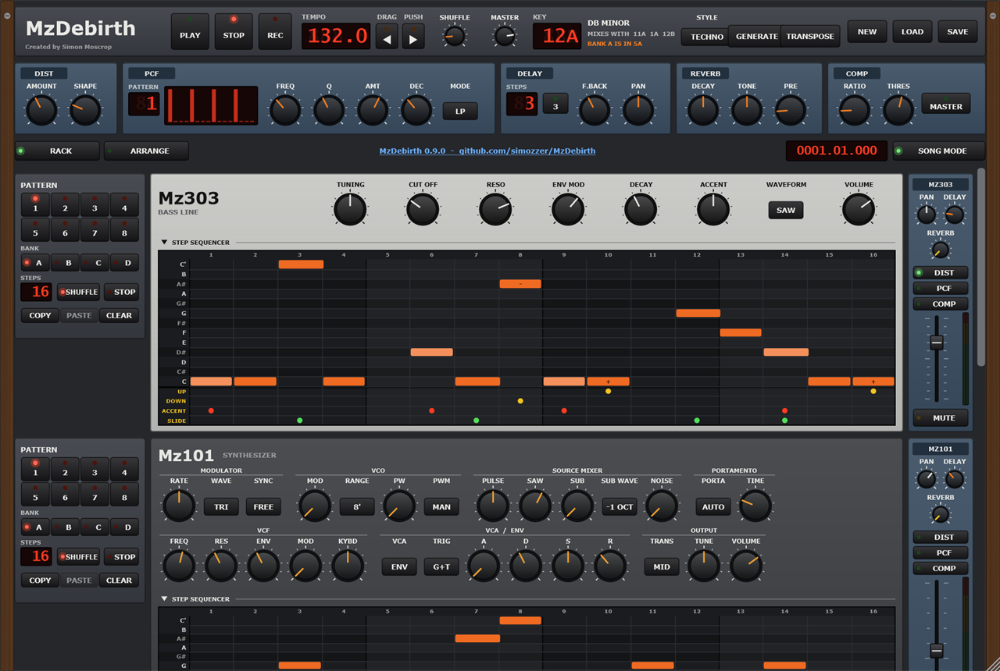
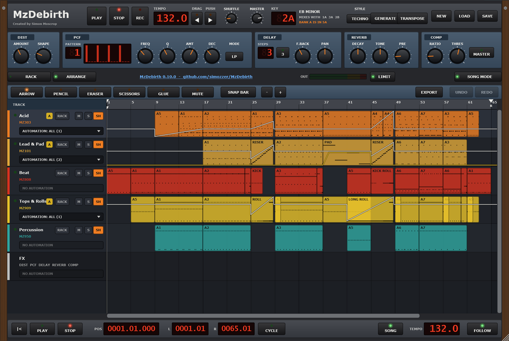

# MzDebirth

A rack of the Mz synths, played from a step sequencer, in the spirit of the old ReBirth
RB-338: five machines, each with its own panel, its own patterns and a channel on the mixer,
all on one clock, with ReBirth's effects units along the top. And beside the rack, an
[Arrange window](#the-arrange-window) after Cubase on the Atari ST, to lay the patterns out
as a song and write parts of any length.

It plays the synths' real engines - [Mz303](https://github.com/simozzer/Mz303),
[Mz101](https://github.com/simozzer/Mz101), [Mz808](https://github.com/simozzer/Mz808),
[Mz909](https://github.com/simozzer/Mz909) and [Mz950](https://github.com/simozzer/Mz950) -
and its PCF is [MzPCF](https://github.com/simozzer/MzPCF)'s. Nothing is copied: each engine
is compiled straight from its own repository, so a fix to a synth or the PCF reaches the rack
too.

## Getting it

Download **MzDebirth-*version*-win64-Setup.exe** from the
[releases page](https://github.com/simozzer/MzDebirth/releases) and run it. It installs the
app, a Start menu entry, an uninstaller, and the Mz950's seven sample disks, a piano among
them; installing for just yourself needs no administrator rights. The **win64.zip** beside
it is the same, to run without installing - keep the `disks` folder next to `MzDebirth.exe`.

Windows 10 or 11, 64-bit. The app is not code-signed, so Windows may warn about an unknown
publisher: choose **More info**, then **Run anyway**.

## Getting started

- **Options** (top left) picks the audio output.
- **The window**: drag it wider and everything grows with it; drag it taller (from 800
  pixels) and you see more of the rack at once, or more of the song. It opens at the size
  it was left.
- **PLAY**, or the space bar. A new rack opens on the **demo song** - an acid rave tune made
  from the factory grooves, two minutes of intro, builds, drops and a breakdown - in the
  Arrange window. Turn **SONG MODE** off and every machine plays its own pattern, A1 to
  start with.
- Pick another pattern on each machine's **PATTERN** pads - bank A to D, then 1 to 8. Picked
  while playing, it blinks, and starts when the pattern playing comes round. The factory
  banks are written so that pattern *n* of every machine plays with pattern *n* of the others:
  **A** acid house, **B** techno, **C** electro, **D** deep house; in each, 1-3, 6 and 7 are
  grooves, 4 and 8 fills, and 5 a breakdown.
- **TEMPO** is to a tenth of a beat a minute: drag it or use the wheel for whole beats, with
  **Shift** held for tenths, and double-click for 120.
- **DRAG** and **PUSH**, beside it, work like the pitch bend on a CD deck, for playing the rack
  in time with a record. Held, they slow the rack or hurry it - 3% at once, building to 10%
  over two seconds - and let go, it is back on its tempo with the beat moved. The tempo shows
  the bent figure while one is held. The **left and right arrow keys** do the same.
- **NEW** brings the factory grooves and the demo song back, or clears the rack to write
  your own.
- **SAVE** and **LOAD** keep whole racks - patterns, knobs, mixer, effects and the song - in
  `.mzdebirth` files. The app also remembers where it was left.
- **RACK** and **ARRANGE** (or F1 and F2), under the effects, switch between the rack and
  the Arrange window, where the patterns become a song - see below.

## The Arrange window

A second way to work, after Cubase on the Atari ST: the song laid out along a ruler of bars,
a track for each machine down the left - the rack's five, in its order, one each - and on
each track *parts*: notes of any length at any position, not 16-step patterns. The rack is
still a click away, for the sound: every knob, fader and effect plays the song as it plays
the patterns, and a track's **RACK** goes straight to its machine.

The **demo song** a new rack opens with shows the way: bank A's grooves laid out over 64
bars at 132 bpm, with parts written for it. In each build the kick drops away, a 909 snare
roll speeds up from quarters to 32nds, and a 101 riser climbs C minor. Each build cuts out a
beat before the drop, which lands with a crash. The breakdown holds the 101 long over the
chords, gliding between them. The 909's track carries both its grooves and the rolls, and
the 101's both the lead and the risers and pad, which take turns.

- **SONG MODE** (beside the tabs) chooses what plays the machines: the song, or - off, as
  ReBirth's PATTERN mode - their patterns. Changed while playing, it waits for the bar.
  PLAY in the Arrange window turns it on.
- **Getting started:** right-click a track's lane and *Insert a pattern* from the rack. It
  becomes a part that plays exactly as the pattern did - slides, accents, ties and shuffle
  and all - so the factory grooves, GENERATE and TRANSPOSE all feed the song.
- **The toolbox** is along the top, and on the right mouse button as on the ST:
  - **ARROW** picks, moves (to another track of the same kind too), copies with Alt-drag, and
    resizes by the right edge.
  - **PENCIL** draws an empty part.
  - **ERASER** and **MUTE** do what they say.
  - **SCISSORS** cuts a part in two.
  - **GLUE** joins a part to the next.
  - **SNAP** sets what they all keep to: a bar, a beat, a sixteenth, or nothing. The
    toolbox menu also *Repeats* parts and renames them.
- **The tracks:** one for each machine, so the song and the rack always match. M mutes a
  track, S solos it, SH has it swing with the SHUFFLE knob, and **RACK** shows that machine
  in the rack, ringed for a moment, to turn its knobs. Right-click a track to rename or
  recolour it. A song saved by 0.5 or before with two tracks for one machine opens with them
  merged into one, sounding as it did.
- **The ruler:** click to move the cursor (and the song, while it plays). Drag the **L** and
  **R** flags for the locators, or shift-drag to set both. Double-click to turn the cycle
  on or off.
- **The transport** along the bottom: back to the start, PLAY from the cursor, STOP, the
  position in bars, beats and ticks, the locators, CYCLE and FOLLOW. The ST's numeric
  keypad works as it did: **Enter** plays, **0** stops, **.** goes back to the start, and
  **/** turns the cycle on and off.
- **Ctrl+Z** undoes any edit to the song and **Ctrl+Y** redoes it. **Ctrl+C** and
  **Ctrl+V** copy parts and paste them at the cursor, **Delete** deletes them, and
  **Ctrl+A** picks every part.

Double-click a part to edit it:

- **KEY EDIT**, for the Mz303, Mz101 and Mz950:
  - the keys down the side, and on the 950 the names of the samples its programme plays;
  - draw notes with the PENCIL, a **Q** long or dragged longer;
  - move and stretch them with the ARROW;
  - on the 303 and 101, a note that overlaps the next slides into it, and is drawn joined
    to it.
- **DRUM EDIT**, for the Mz808 and Mz909: the instruments down the side. The STICK strikes
  a step, takes a hit away, or accents it with Alt-click.
- **Both editors:**
  - drag across the **VELOCITY** lane to draw the velocities - 110 and up is an accent;
  - **Q** sets the grid, and **QUANTIZE** (or the Q key) moves the notes picked, or all of
    them, on to it;
  - **Escape** goes back to the Arrange window.

## The machines

- **Mz303** - the full panel, and a piano-roll step editor with the 303's UP, DOWN, ACCENT
  and SLIDE on every step. Click a cell for a note, click it again for a rest, drag along
  to keep going. A slide holds the note over into the next step and glides to it.
- **Mz101** - the panel in its sections, less what the rack does for it (its arpeggiator,
  sequencer and clock). The same step editor without ACCENT, which the 101 has none of; its
  SLIDE is a legato, which glides when PORTAMENTO is on AUTO. SYNC on TEMPO locks its
  modulator to the rack.
- **Mz808** and **Mz909** - the full panels, a column per instrument, and the hardware's way
  of writing a beat: pick an instrument on the select row (or AC for the accents) and its
  steps show on the sixteen keys. An instrument with steps written has a bright edge.
- **Mz950** - plays S900/S950 disk images: **LOAD DISK**, then pick a programme. Its steps
  are a grid of notes, any number on a step, with ACCENT and TIE rows; a tied step carries
  on the notes it shares with the step before. The keys the programme plays are lit, and a
  drum kit's are named by their samples. It opens with the drum disk that comes with Mz950.

The step editors of the **Mz303**, **Mz101** and **Mz950** fold away: click the
**STEP SEQUENCER** bar over one, and the machine folds down to its knobs, its pattern
section and mixer strip packing down beside them (the inserts and MUTE as lettered keys that
glow when on, the fader and meter on their sides). The bar stays where it was, under the knobs, to unfold
it again. The rack remembers which are folded.

Every machine has four banks of eight patterns, of up to sixteen steps (**STEPS**), with
**COPY**, **PASTE** and **CLEAR**, and its own **SHUFFLE** switch: whether it swings with the
transport's SHUFFLE knob.

## Effects and the mixer

ReBirth's four units, along under the transport:

- **DIST** - drive, and a shape from soft, to hard, to a lopsided fuzz.
- **PCF** - a filter played by one of 32 step patterns: struck on every sixteenth at that
  step's level, closing again by DEC; low-pass or band-pass. The same as the
  [MzPCF](https://github.com/simozzer/MzPCF) plugin, to use on any track in a DAW.
- **DELAY** - echoes 1 to 16 sixteenths behind at the rack's tempo, or triplets, with
  feedback and pan. They ring on after STOP.
- **COMP** - ratio and threshold, for the channels switched into it, and for the whole mix
  with **MASTER**.

Each machine's mixer strip has its pan, its **DELAY** send, its switches into **DIST**,
**PCF** and **COMP** - in that order, before the fader - its fader and **MUTE**, and a
stereo **meter** beside the fader. The meter reads what the machine puts into the output,
after its fader, pan and the MASTER: green to -12 dB, yellow to 0, and red over it, where
that machine alone would take the output past full scale. It falls as a peak meter does,
with the highest point held for a second.

## Keys, for harmonic mixing

The **KEY** section names the key as Mixed In Key does, on the Camelot wheel: **1A-12A**
are minor, **1B-12B** major. Drag it or use the wheel to go round; click to swap A and B. It
shows the keys that mix with it, and the key of the bank the Mz303 is showing.

- **GENERATE** fills that bank, on every machine, with eight new grooves in the key and the
  **STYLE** - acid, techno, electro or deep - laid out as the factory banks are: bass lines
  and leads from the key's scale over a progression of its chords, drums varied from the
  style's factory patterns, and the Mz950 playing a kit's percussion or a tuned programme's
  chords. Every press writes new ones.
- **TRANSPOSE** moves that bank's bass lines and leads into the key, degree for degree - so
  C minor sent to 8B becomes C major, not just a different pitch. A bank written by hand has
  its key worked out from its notes. The drums are left as they are.

## Building

On Windows, with Visual Studio's C++ tools. The repositories go side by side:

    src\
        JUCE\         9.0.2
        Mz101\
        Mz303\
        Mz808\
        Mz909\
        Mz950\        (or VirtualS950, its old name)
        MzPCF\
        MzDebirth\

Mz950's sample disks are not in its repository. Make them once, with its disk generator:

    ..\Mz950\AkaiS950Synth\build.ps1 -To ..\Mz950\disks

then

    .\build.ps1             the sequencer check, then the standalone app
    .\build.ps1 -NoApp      the check only
    .\build.ps1 -Release    and the installer and the zip, into dist\ (needs Inno Setup 6)

The check (`Tests/SeqCheck.cpp`) holds the sequencer to its timing, slides and pattern
changes, checks each effect and every factory groove, generates in all 24 keys, and plays
each machine, before the app is built round it. It also holds the song to its sample: every
factory groove made into parts must play bit for bit as its patterns do, and the cycle,
STOP, undo, and a song edited while it plays are each checked. The demo song is played
through and held to its shape: drops louder than the intro and the breakdown, and a beat of
near silence before each. It links no JUCE. Without the disks it skips
the Mz950's checks and says so; `-Release` will not go on without them.

Pushing a version tag (`git push origin v0.3.0`) builds the installer and zip on GitHub -
disks and all - and attaches them to a draft release, with the notes in
`docs/releases/<tag>.md`.

Any of the other repositories can be somewhere else: pass `-DJUCE_PATH=`, `-DMZ101_PATH=`,
`-DMZ303_PATH=`, `-DMZ808_PATH=`, `-DMZ909_PATH=`, `-DMZ950_PATH=` or `-DMZPCF_PATH=` to
cmake.

## Layout

    Source/Core         the clock, patterns, machines, effects, mixer, keys and grooves - no JUCE
                        Song.* and SongPlayer.h: the song, and how the audio thread plays it;
                        DemoSong.*: the demo song
    Source/UI           the panels
    Source/UI/Arrange   the Arrange window, and KEY EDIT and DRUM EDIT
    Source/Processor.*  the rack as a JUCE processor, and its saved state
    Tests/SeqCheck.cpp  the check
    installer/          the Inno Setup script, and the zip's README

## Licence

Created by Simon Moscrop.

Free software under the GNU AGPL v3, as the synths it plays; see LICENSE.

ReBirth and RB-338 are Propellerhead's; TB-303, SH-101, TR-808 and TR-909 are Roland's; S900
and S950 are Akai's; Mixed In Key is Mixed In Key LLC's. MzDebirth is an independent project
and is not affiliated with any of them.
